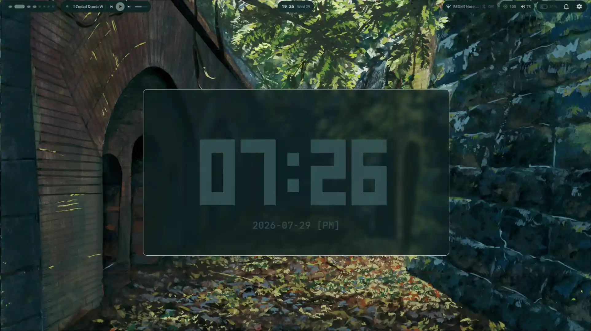
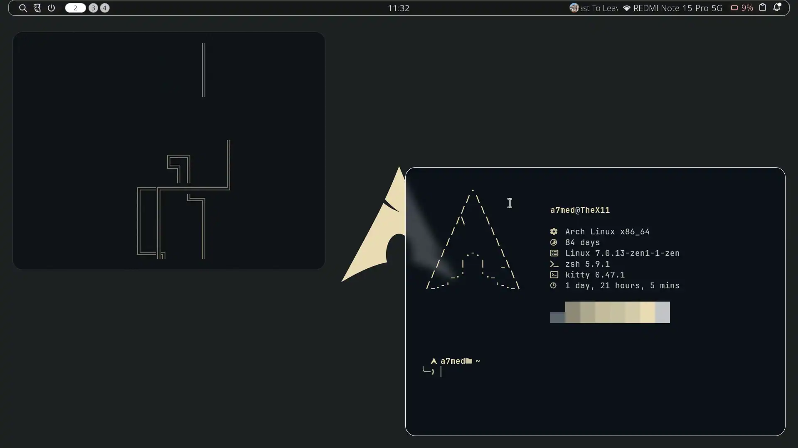
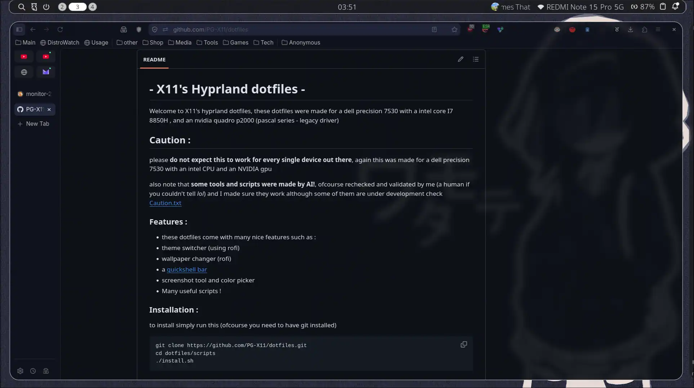
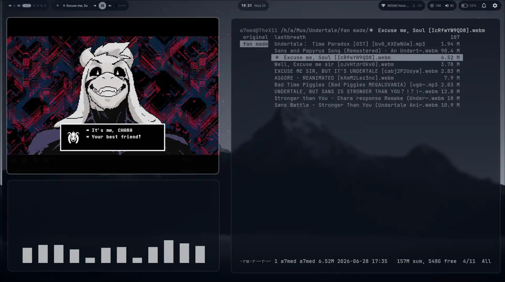
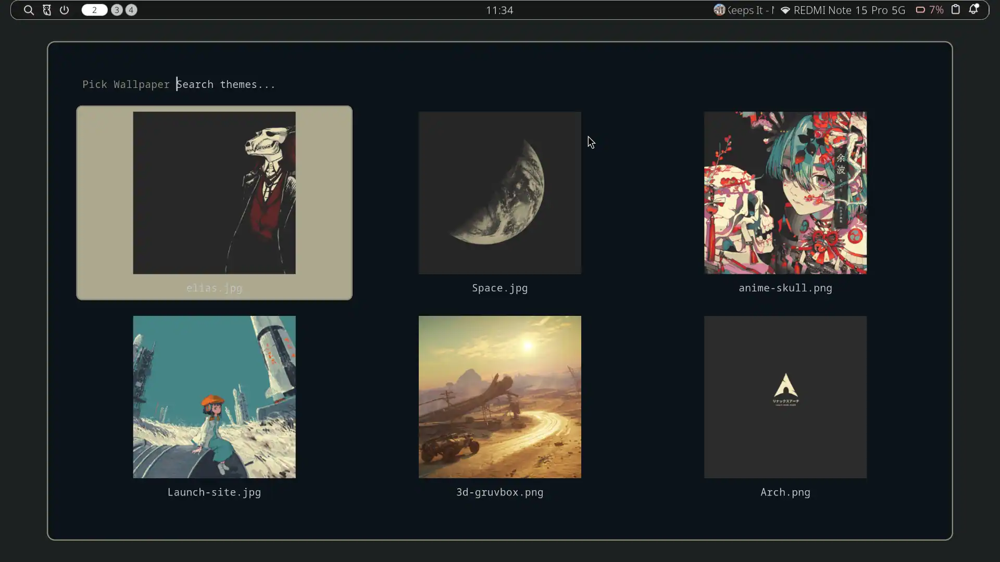
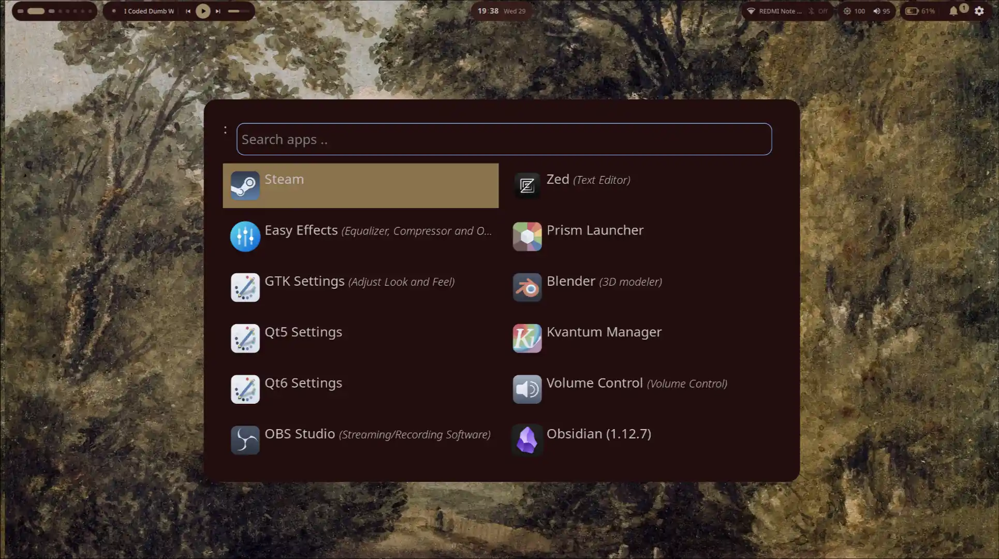
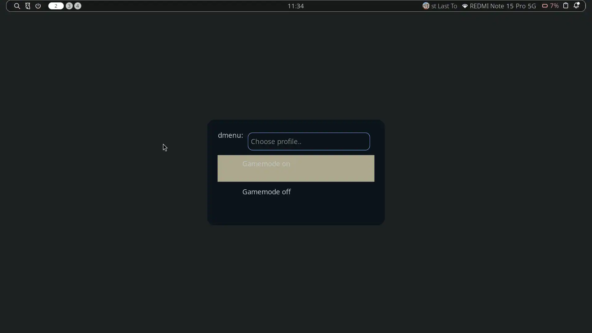

# - X11's Hyprland dotfiles - 
Welcome to X11's hyprland dotfiles, these dotfiles were made for a dell precision 7530 with a intel core I7 8850H , and an nvidia quadro p2000 (pascal series - legacy driver)  

## Caution : 
please **do not expect this to work for every single device out there**,
again this was made for a dell precision 7530 with an intel CPU and an NVIDIA gpu

also note that **some tools and scripts were made by AI!**, ofcourse rechecked and validated by me (a human if you couldn't tell *lol*) and I made sure they work although some of them are under development 
check [Caution.txt](/assets/Caution.txt)
### Features : 
- these dotfiles come with many nice features such as :
- theme switcher (using rofi)
- wallpaper changer (rofi) 
- [Noctalia shell](https://github.com/noctalia-dev/noctalia)
- screenshot tool and color picker 
- Many useful scripts !
### Installation :
to install simply run this (ofcourse you need to have git installed)
```
git clone https://github.com/PG-X11/dotfiles.git
cd dotfiles/scripts
./install.sh
```

### Preview :

#### Themes :
as mentioned earlier X11's rice also has a theme swithcer (yay!!)
here are some screenshots of some themes that are here 

##### Everforest : showing workspace 1

<p align="center">
  
</p>

##### Gruvbox : showing workspace 2

<p align="center">
  
</p>

##### Cattpuccin mocha: showing workspace 3

<p align="center">
  
</p>

##### Nordic blue  : showing workspace 4

<p align="center">
  
</p>

*Note: a theme is still not completed (rose pine) since I am trying to find better and cleaner wallpapers, gtk themes, kvantum configurations and many more ricing materials to make them feel complete and polished*

*Note : if you clear the cache using something like 'stacer' it might break the wallpaper cache and some functionality, if that happenes switching the theme will easily fix it!*

#### Scripts :
##### Wallpaper Changer

<p align="center">
  
</p>

##### App Menu

<p align="center">
  
</p>

##### Gamemode

<p align="center">
  
</p>
there are many more scripts, you can inspect the keybinds to figure them out ! 


### Credit :
cant really credit all the sources for the wallpapers, and other things I forked 
sadly did not keep track of them so if you find something yours tell me and I will gladly credit you here ! 

> [Noctalia shell](https://github.com/noctalia-dev/noctalia)
### To-Do

Making a favorite app menu (I love rofi),
finish the themes and add a new theme called 'neon' or 'futuristic' or 'cyberpunk'
find a good cli configurable music player, something like cliamp but more configurable 
### Notes

Udev rule created for igpu and dgpu, symlinked as igpu and dgpu 
